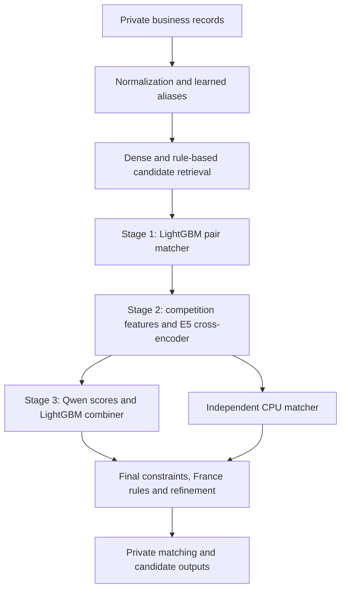

# Amazon ML Challenge 2026 — Business Entity Resolution

GitBoosters' solution for matching businesses across three noisy data sources at large scale. The pipeline combines multilingual dense retrieval, LightGBM matching, cross-encoder features, offline Qwen pair classifiers, and a second CPU matcher for uncertain decisions.

GitBoosters appears in the organizers' [Top 50 Teams results](https://docs.google.com/spreadsheets/d/e/2PACX-1vQDMSduegekOef-4HZUTZcV-OVzn-3jymCVab6Xeuw5W934u25dSbetTJ65ikoWUxmIPraEakUYZ8QH/pubhtml?gid=1284921920). The final submitted variant was **#27-19**, with a recorded **public leaderboard macro-F0.5 of 0.989275**. Top 50 is the published final result; the sheet does not give an exact rank or private score. The public score comes from our submission records and is a different measurement from local validation.

## The task

Source 1 contains canonical business entities. For each entity, the system must find all matching records in Sources 2 and 3, including the possibility of no matches. Names and addresses contain spelling errors, transliterations, missing fields, reordered words, and misleading near-duplicates.

The test set contains approximately **1.73 million reference entities** and **9.97 million candidate records**. Training labels cover the US and India; France appears only at test time. Exhaustive comparison is impractical, and a false positive is expensive under the precision-weighted F0.5 metric.

## How the solution works

1. Normalize names and addresses. Learn transliteration and alias maps from the training portion; use high-confidence pseudo-pairs for label-free adaptation.
2. Retrieve candidates with a fine-tuned multilingual bi-encoder and indexed nearest-neighbor search, alongside exact-name, address-number, and character-gram channels. The union is capped at 30 candidates per reference entity.
3. Score pairs with LightGBM using name/address similarities, number agreement, record flags, retrieval ranks, and contextual features.
4. Re-rank uncertain pairs using cross-fitted competition features and a fine-tuned multilingual cross-encoder.
5. Add offline Qwen pair-classifier scores in the uncertain band and combine them with a learned tabular model.
6. Apply the final assembly: France-specific rules, one-owner and source-count constraints, the stage-3 refit, CPU-matcher tie-breaking, expected-F0.5 refinement, and an audit correction.



See [methodology](docs/methodology.md) for the validation boundaries and final assembly. The source contains earlier experiments as well as the selected pipeline; inclusion does not mean an experiment contributed to the final result.

## Repository contents

```text
code/business_entity_resolution/
  src/ber/                         main pipeline and experiment source
  src/ber/final2719/               final submission assembly and audit code
  src/teammate_reference/          France rules and independent CPU matcher
  requirements.txt                main pipeline dependency pins
  reproduce_final*.sh             historical inference/assembly entry points
  stage_artifacts.sh              stage a separately held private artifact kit
docs/
  methodology.md                  approach, results, and validation limits
  reproduction.md                 training and private-artifact reproduction
  public-content.md               publication boundaries
scripts/check_public_release.py   content and reachable-history checks
```

The public history is reconstructed from archived development commits and the final submission package. Source changes retain the original dates where available; private-only checkpoints are omitted, and the final submission documentation is kept in a separate post-challenge checkpoint.

This is a **source release**. Challenge data, example records, entity IDs, prediction files, candidate lists, learned dictionaries, trained models/adapters, submission archives, organizer documents, and internal work logs are excluded. We do not redistribute the challenge dataset.

## Getting started

The main pipeline was developed with Python 3.10 and CUDA 12.1. Its training and dense retrieval require a suitable NVIDIA GPU. The primary development GPU was an RTX A6000 with 48 GB VRAM; a separate CPU matcher was developed on an 8-core laptop. Set the thread budget for your machine rather than using the original 96-thread setting unchanged.

```bash
python3.10 -m venv .venv
source .venv/bin/activate
python -m pip install -r code/business_entity_resolution/requirements.txt \
  --extra-index-url https://download.pytorch.org/whl/cu121
export PYTHONPATH="$PWD/code/business_entity_resolution/src"
export BER_ROOT="$PWD"
export BER_PROCS=8
```

Only users who already have authorized access to the challenge data can run dataset training or evaluation. [Reproduction instructions](docs/reproduction.md) give the data layout, pinned base-model revisions, training stages, and requirements for the exact final assembly. A fresh clone does not contain everything needed to reproduce the submitted TSV. Retraining is also not a guarantee of byte-identical predictions.

## Team

- [Yash Kumar Vaibhav](https://github.com/yashkumarvaibhav) — team leader
- [Pinaksh Kumar](https://www.linkedin.com/in/pinaksh-kumar-10b423361/)
- Keyur Kumar Desai
- Priyanshu

All team members are from Indraprastha Institute of Information Technology (IIIT), Delhi. Pinaksh contributed the independent CPU matcher used for tie-breaking and France post-processing.

## License and third-party components

The team's source code is released under the [MIT License](LICENSE). Dependencies and pretrained base models retain their own licenses; the repository's MIT license does not relicense them or the challenge data. See [NOTICE.md](NOTICE.md).
